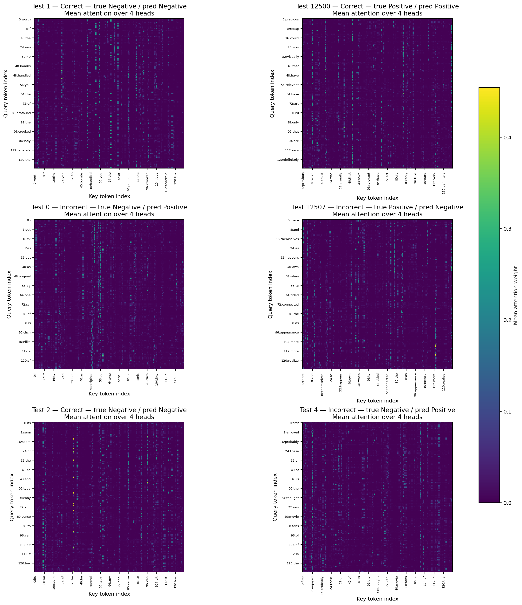

# Bài 26 — Error Analysis

## 1. Giới thiệu

Phân tích dưới đây dùng mô hình Transformer encoder một block, 4 attention heads, `d_model=128`, masked mean pooling và `max_length=128`. Mô hình được đánh giá trên 25.000 review test IMDb có nhãn. Tập train/validation/test giữ theo cách chia của Lab 5: 20.000/5.000/25.000; vocabulary chỉ được tạo từ train. Chọn sáu ví dụ theo thứ tự ổn định, có cả TN, TP, FP, FN, gồm ba dự đoán đúng và ba dự đoán sai.

**Nguồn model:** checkpoint `checkpoints/transformer_heads4_mean.pt`. Không tìm thấy checkpoint cũ của Lab 7 nên đã train lại duy nhất mô hình này (5 epochs), không chạy lại toàn bộ experiment. Metrics test và lịch sử validation năm epoch khớp các giá trị đã lưu trong `results.csv` và `learning_curves.csv`; thời gian train của lần chạy mới không được dùng thay cho thời gian cũ. Do checkpoint ban đầu vắng mặt, không thể xác nhận hai lần chạy đã có cùng weights, dù metrics/loss khớp.

## 2. Hiệu năng tổng thể trên Test

| Accuracy | Precision (Positive) | Recall (Positive) | F1 (Positive) |
| ---: | ---: | ---: | ---: |
| 0.80712 | 0.80286 | 0.81416 | 0.80847 |

Confusion matrix, hàng là nhãn thật và cột là dự đoán:

|  | Dự đoán Negative | Dự đoán Positive |
| --- | ---: | ---: |
| Thật Negative | TN = 10.001 | FP = 2.499 |
| Thật Positive | FN = 2.323 | TP = 10.177 |

Các số trên cộng thành 25.000 review và khớp các metrics trong `results.csv`.

## 3. Ba ví dụ phân loại đúng

| Test index | Nhãn thật → dự đoán | Xác suất nhãn dự đoán | Độ dài gốc → giữ lại | Categories có evidence |
| ---: | --- | ---: | ---: | --- |
| 1 | Negative → Negative (TN) | 0.9156 | 213 → 128 | Long sequence, truncation, contrast/mixed evaluation |
| 2 | Negative → Negative (TN) | 0.9244 | 134 → 128 | Negation, long sequence, truncation |
| 12500 | Positive → Positive (TP) | 0.9607 | 142 → 128 | Long sequence, truncation, OOV proper names |

Các trích dẫn ngắn này là từ review gốc. Phân loại đúng không chứng minh mô hình chỉ dựa vào một từ cụ thể.

## 4. Ba ví dụ phân loại sai

| Test index | Nhãn thật → dự đoán | Xác suất nhãn dự đoán | Độ dài gốc → giữ lại | Categories có evidence |
| ---: | --- | ---: | ---: | --- |
| 0 | Negative → Positive (FP) | 0.7477 | 240 → 128 | Negation, contrast, long sequence, truncation |
| 12507 | Positive → Negative (FN) | 0.7002 | 208 → 128 | Long sequence, truncation, rare/OOV names, nuanced wording |
| 4 | Negative → Positive (FP) | 0.9446 | 134 → 128 | Negation, contrast, truncation, ambiguous/mixed sentiment |

## 5. Phân tích lỗi chi tiết

### Test index 0 — False Positive

**Quan sát:** nội dung đầu câu “I love sci-fi” mang sắc thái thích thể loại, nhưng đối tượng review bị chê rõ: “Silly prosthetics, cheap cardboard sets” và “It's clichéd and uninspiring.” Mô hình dự đoán Positive với xác suất 0.7477. Sau khi giới hạn ở 128/240 token, mô hình không nhận phần còn lại của review, trong đó tác giả tiếp tục gọi phim là “dull” và “rubbish”.

**Giả thuyết cần kiểm tra:** truncation có thể làm mất nhiều bằng chứng tiêu cực về sau; đồng thời câu có từ tích cực xen giữa các đánh giá chê. Tuy vậy, những từ chê cũng đã có trong phần được giữ, nên truncation riêng lẻ chưa giải thích đầy đủ prediction. Có thể còn ảnh hưởng từ cách tổng hợp token hoặc các quan hệ giữa câu.

**Attention quan sát:** token nhận attention trung bình cao nhất theo từng head lần lượt là `silly` (H1, 0.1224), `cheap` (H2, 0.1617), `stilted` (H3, 0.1320), `cg` (H4, 0.2877). Một số từ này xuất hiện trong câu chê, nhưng weights này không chứng minh chúng đã gây ra dự đoán Positive.

**Evidence sau preprocessing:** đầu review được biến thành `i love sci fi ...`; phần giữ lại còn `silly`, `cheap`, `doesn't`, `not`, `uninspiring`, nhưng kết thúc ở `it may treat important issues`. 112 token tiếp theo không được đưa vào model.

### Test index 12507 — False Negative

**Quan sát:** review dài về phim *FIRE*; phần được giữ tới “...come to realize they share a lot more than common”. Đoạn kết tích cực “it's a very beautiful picture, and a strong voice from a strong director” bị bỏ khỏi input. Trong 128 token còn lại có 10 token OOV, gồm nhiều tên riêng. Mô hình dự đoán Negative với xác suất 0.7002.

**Giả thuyết cần kiểm tra:** mất câu kết tích cực do truncation và việc nhiều tên riêng ánh xạ thành UNK có thể làm biểu diễn nghèo thông tin hơn. Đây là review thiên về mô tả chủ đề, quan hệ và bối cảnh xã hội, thay vì dùng liên tục các từ sentiment trực tiếp; điều này cũng có thể gây khó cho classifier. Chưa thể xác định yếu tố nào là nguyên nhân chính từ một ví dụ.

**Attention quan sát:** top token mỗi head là `theme` (H1, 0.1777), `masculine` (H2, 0.1251), `common` (H3, 0.1291), `sometimes` (H4, 0.1758). Các top này không trùng với câu kết tích cực đã bị cắt; attention chỉ được tính trên phần input còn lại.

**Evidence sau preprocessing:** phần input kết thúc bằng `... they share a lot more than common`; câu chứa `a very beautiful picture` bị cắt hoàn toàn. Các tên `deepa`, `mehta's`, `shabana`, `azmi`, `nandita`, `das` và các token tên riêng khác có trong danh sách UNK được lưu ở CSV. Đây là evidence cho truncation/OOV, không khẳng định chúng là nguyên nhân duy nhất.

### Test index 4 — False Positive

**Quan sát:** review vừa nói một số phim Van Damme có cốt truyện/diễn xuất chưa tốt, vừa khẳng định “I enjoy these kinds of movies”, “it's worth watching” và “Good fun stuff!” Mô hình dự đoán Positive với xác suất 0.9446. Sáu token cuối, bao gồm câu kết ngắn, bị cắt; tuy nhiên review vẫn còn các cụm tích cực chính.

**Giả thuyết cần kiểm tra:** đây là trường hợp đánh giá có điều kiện và pha trộn khen/chê. Mô hình có thể phản ứng mạnh với các cụm tích cực, nhưng không thể khẳng định cơ chế đó chỉ từ attention. Việc bỏ câu kết cũng không giải thích rõ lỗi vì câu kết vốn tích cực.

**Attention quan sát:** token top theo head là `enjoyed` (H1, 0.2145), `van` (H2, 0.1104), `let` (H3, 0.1373), `like` (H4, 0.1309). H1/H4 ưu tiên token tích cực trong review; đây là tương quan quan sát được, không phải bằng chứng nhân quả.

**Evidence sau preprocessing:** trong chuỗi token có `you probably will not like this movie`, rồi `i enjoy these kinds of movies`, `van damme is good`, `it's worth watching`; input bị cắt sau `... the same type of feel to it as`, trước câu gốc “Good fun stuff!” Đây là evidence cho phủ định có điều kiện, tương phản và truncation ngắn.

## 6. Attention pattern analysis

Bảng dưới ghi token có **mean attention nhận được cao nhất** trên mỗi head của từng review. Trọng số được tính từ attention thực tế trên input đã tokenize, sau truncation; các token được hiển thị theo dạng lowercase sau preprocessing.

| Test index / loại | Head 1 | Head 2 | Head 3 | Head 4 |
| --- | --- | --- | --- | --- |
| 1 — đúng TN | `value` 0.2538 | `interesting` 0.1263 | `blows` 0.2231 | `entertaining` 0.2148 |
| 2 — đúng TN | `few` 0.2183 | `van` 0.1729 | `alright` 0.1250 | `type` 0.1104 |
| 12500 — đúng TP | `recap` 0.2894 | `75` 0.1702 | `wonderful` 0.2745 | `sense` 0.1138 |
| 0 — sai FP | `silly` 0.1224 | `cheap` 0.1617 | `stilted` 0.1320 | `cg` 0.2877 |
| 12507 — sai FN | `theme` 0.1777 | `masculine` 0.1251 | `common` 0.1291 | `sometimes` 0.1758 |
| 4 — sai FP | `enjoyed` 0.2145 | `van` 0.1104 | `let` 0.1373 | `like` 0.1309 |

Mỗi ô ghi token và trọng số trung bình; `error_attention_evidence.csv` lưu top 5 token mỗi head. Hình `error_attention_examples.png` hiển thị ma trận attention trung bình 4 heads cho đúng sáu review này. Attention là trọng số tương tác giữa token tại lớp được đo; nó không tự cho biết ảnh hưởng nhân quả lên nhãn. Một token có trọng số lớn vẫn có thể không phải lý do duy nhất cho output.

Các category `noise` và `domain shift` không được gán cho sáu mẫu này vì không có bằng chứng đủ rõ để gán. Tên riêng/OOV và câu dài được ghi nhận như hiện tượng trong input; mức độ ảnh hưởng cần được kiểm tra thủ công.

## 7. Model behavior và diễn giải của người đọc

**Model behavior đo được:** sáu review có xác suất, nhãn dự đoán, độ dài token gốc/giữ lại và attention weights được lưu trong `error_samples.csv` và `error_attention_evidence.csv`. Mô hình xử lý đúng cả ba ví dụ được chọn và sai cả ba ví dụ còn lại; lựa chọn ví dụ này có chủ đích để thỏa yêu cầu 3/3, vì vậy không đại diện cho tần suất lỗi toàn test. Trên toàn test, F1 là 0.80847.

**Diễn giải cần xác minh thủ công:** truncation có thể liên quan đến lỗi ở index 0 và 12507, còn cách biểu đạt pha trộn có thể liên quan đến index 4. Đây là giả thuyết từ văn bản bị cắt và nội dung quan sát được; không thể khẳng định quan hệ nhân quả bằng sáu ví dụ hoặc heatmap. Cần thử thay đổi độ dài, xem các review tương tự và đối chiếu dự đoán khi giữ/bỏ các đoạn để kiểm chứng.

## 8. Kết luận và giới hạn

Trong các lỗi đã chọn có hai FP và một FN; hai review sai bị cắt khá nhiều token, một review chỉ bị cắt sáu token. Điều này gợi ý truncation là một yếu tố đáng kiểm tra, nhưng không đủ để kết luận đó là nguyên nhân chung của lỗi. Attention top token thay đổi giữa các review và head, song không chứng minh mô hình “chú ý sai” dẫn đến nhãn sai. Phân tích chỉ dùng sáu mẫu được chọn từ 25.000 test review và một kiến trúc 4-head; các kết luận không khái quát thành mọi review hay mọi Transformer. Checkpoint gốc không có sẵn nên mô hình được train lại một lần cho tác vụ này; metrics/loss khớp artifacts, nhưng không có bằng chứng đối chiếu weights ban đầu.
